# ⚡ Awesome Developer Tools & IDEs 🛠️

**A curated index of premier SaaS developer platforms and battle-tested open-source development environments.**  
*Empowering engineers with high-performance native compilation, cross-platform toolchains, and platform-specific SDKs.*

 

**Last Updated: October 2026** • Maintained by [@ishandutta2007](https://github.com/ishandutta2007)

---

## 📑 Table of Contents

- [🔍 Sector Overview & Market Dynamics](#-sector-overview--market-dynamics)
- [☁️ SaaS & Hosted Platforms](#️-saashosted-platforms)
- [🔓 Open-Source GitHub Projects](#-open-source-github-projects)
- [💡 How to Contribute](#-how-to-contribute)
- [💖 Support & Sponsorship](#-support--sponsorship)
- [📈 Star History](#-star-history)
- [⚠️ Disclaimer](#️-disclaimer)

---

## 🔍 Sector Overview & Market Dynamics

The global **Integrated Development Environment (IDE)** and **developer tooling** market is estimated at approximately **$4.5B to $10B+** (with projections anticipating **$25B–$30B+** by the early 2030s at an estimated ~10–14% CAGR, accelerated by agentic coding assistants, intelligent Language Server Protocol (LSP) integrations, and containerized cloud developer workspaces).

The market structure exhibits a **moderately concentrated** core:
- **Ecosystem Giants at the Center**: Operating system and cloud platform vendors (**Apple**, **Microsoft**, and **Alphabet / Google**) maintain defensible moats around official platform SDKs, native compilers (Clang/LLVM, MSVC), and official app store deployment conduits. Alongside commercial powerhouse **JetBrains**, they capture the bulk of enterprise licensing.
- **Vibrant Open-Source & Modular Fragmentation**: Counterbalancing the top-heavy core is an intensely vibrant, **fragmented** tier of community-driven code editors (VS Code, Neovim, Zed, Helix), language-specific runtimes, cross-platform build systems (CMake, SwiftPM, Meson), and terminal workflows. Modern developers routinely stack multiple specialized tools across varied target environments rather than relying on a single monolithic system.

---

## ☁️ SaaS & Hosted Platforms

A comprehensive breakdown of enterprise-grade developer suites, hosted toolchains, and proprietary IDE environments, sorted descending by parent company valuation and market capitalization:

| Product | Company Valuation / Revenue | Starting Pricing | Free Tier Limits | Description & Trade-offs |
|---|---|---|---|---|
| **Apple Xcode** | Market Cap: ~$4.02T (Revenue: ~$391B) | $99/year (Apple Developer Program starting tier required for App Store distribution) | Free to download and build locally / on tethered personal devices (free Apple ID); limited to personal provisioning profiles and 7-day personal certificate validity without paid membership | **Apple's official IDE for iOS, macOS, watchOS, and tvOS development**. The **only complete toolchain** for building, signing, and deploying iOS apps to the App Store—bundles SwiftUI previews, simulators, Instruments profiling, and Apple Developer Services integration. **The baseline for iOS development**. **Trade-offs**: massive install size, frequent upgrades, and strictly requires macOS. |
| **Android Studio** | Market Cap: ~$3.78T (Alphabet) (Revenue: ~$350B) | $25 one-time registration fee (Google Play Console account starting tier to publish apps) | Free forever IDE download without functional restrictions for local compilation, testing, and debugging on emulator or physical devices; publishing requires a $25 one-time registration fee | **Google's official IDE for Android development**. Bundles the Android SDK, emulator, and Gradle build system. **The baseline for Android app development**—no viable complete alternative. |
| **Microsoft Visual Studio** | Market Cap: ~$3.60T (Revenue: ~$245B) | $45/user/month (Visual Studio Professional Cloud Subscription) | Free perpetual Community edition limited to individual developers, open-source projects, classroom learning, and non-enterprise organizations (≤250 PCs and ≤$1M annual revenue) capped at 5 users | **Microsoft's professional-grade IDE** with the MSVC compiler and best-in-class debugger. **The Windows C++ standard**—IntelliSense is genuinely intelligent, and the debugger surfaces state better than any alternative. **Trade-offs**: multi-gigabyte install and a complex workload selector that overwhelms first-timers. |
| **JetBrains CLion** | Valuation: $1B–$10B bracket (Private) (Revenue: ~$700M / 15B CZK) | $9.90/user/month or $99/user/year (Personal); $22.90/user/month or $229/user/year (Commercial) | Free forever for non-commercial use (learning, student/hobby projects, open-source creation); 30-day full-featured free trial with all features enabled for commercial evaluation | **JetBrains' C++ IDE with deep CMake and refactoring support**. **The best choice for structured C++ projects**—refactoring across a hundred files is safe, and integration with CMake is first-class. **Trade-offs**: commercial license required for professional/business use, and heavier than lightweight editors. |
| **JetBrains AppCode (Deprecated)** | Valuation: $1B–$10B bracket (Private) (Revenue: ~$700M / 15B CZK) | Discontinued ($89/user/year personal / $199/user/year commercial when active) | 30-day evaluation trial (historical); product sunset on Dec 14, 2022 and no longer available for purchase or renewal | **Discontinued in 2022**—JetBrains ended sales and support for AppCode, and also discontinued CLion's Swift plugin. **The historical choice** for iOS/macOS development with JetBrains refactoring. **Do not adopt for new projects**—migrate to Xcode for Apple development or CLion for C++. |

---

## 🔓 Open-Source GitHub Projects

Explore the most prominent open-source IDEs, modern code editors, and cross-platform compilation toolchains. All repositories are **ranked and sorted in descending order by GitHub Stars_Count**. Each project includes a real-time stargazer badge linking directly to its GitHub stargazers page.

- ### [Visual Studio Code](https://github.com/microsoft/vscode) 
  - **License**: MIT / Source-available binaries
  - **Overview**: The world's most widely adopted open-source code editor. Features rich Language Server Protocol (LSP) support, seamless debugging integration, built-in Git control, terminal emulation, and tens of thousands of community extensions.
  - **Key Strengths**: Unmatched ecosystem, versatile multi-language workflows, and fast configuration.

- ### [Neovim](https://github.com/neovim/neovim) 
  - **License**: Apache-2.0 / Vim License
  - **Overview**: Vim-fork aggressively focused on extensibility, asynchronous plugin architecture, and first-class Lua scripting. Built-in Tree-sitter parsing and LSP client provide IDE-grade capabilities in an ultra-fast terminal environment.
  - **Key Strengths**: Blazing fast startup, keyboard-driven velocity, zero UI latency, and powerful terminal remote editing.

- ### [Zed](https://github.com/zed-industries/zed) 
  - **License**: GPL-3.0 / AGPL-3.0 / Apache-2.0
  - **Overview**: High-performance, multiplayer code editor engineered in Rust by the creators of Atom and Tree-sitter. Leverages GPU-accelerated rendering to deliver sub-millisecond keystroke responsiveness and built-in collaborative pairing.
  - **Key Strengths**: GPU-rendered text pipeline, minimal memory overhead, instant load times, and native AI/CRDT multiplayer pairing.

- ### [Helix](https://github.com/helix-editor/helix) 
  - **License**: MPL-2.0
  - **Overview**: A post-modern modal terminal text editor written in Rust. Features Kakoune-inspired multiple selections, built-in Tree-sitter syntax highlighting, and out-of-the-box LSP support requiring zero complex plugin configuration.
  - **Key Strengths**: Pure Rust binary, complete out-of-the-box LSP functionality, and clean modal editing.

- ### [Vim](https://github.com/vim/vim) 
  - **License**: Vim License (Charityware)
  - **Overview**: The legendary ubiquitous text editor present on virtually every Unix/Linux server on Earth. Highly configurable modal editing paradigm that maximizes developer keyboard productivity.
  - **Key Strengths**: Universal server availability, tiny memory footprint, and decades of rock-solid stability.

- ### [Lapce](https://github.com/lapce/lapce) 
  - **License**: Apache-2.0
  - **Overview**: Lightning-fast desktop code editor written in pure Rust with a GPU-accelerated UI rendered with Floem. Features native remote development capabilities (SSH, WSL, containers) and WASM-based plugin extensibility.
  - **Key Strengths**: Native speed, built-in modal editing mode, remote container execution, and modern Rust design.

- ### [VSCodium](https://github.com/VSCodium/vscodium) 
  - **License**: MIT
  - **Overview**: Community-driven binary releases of Microsoft's `vscode` repository built with genuine open-source cleanliness—completely free of Microsoft telemetry, tracking, and proprietary binary licensing.
  - **Key Strengths**: Drop-in VS Code experience with strict privacy compliance and 100% free software licensing.

- ### [Eclipse Theia](https://github.com/eclipse-theia/theia) 
  - **License**: EPL-2.0
  - **Overview**: Extensible cloud and desktop IDE platform implemented in TypeScript. Designed from the ground up for organizations to build custom browser-based and desktop IDE products, supporting the VS Code extension protocol.
  - **Key Strengths**: Enterprise modularity, vendor-neutral governance, and cloud workspace embedding.

- ### [xtool](https://github.com/xtool-org/xtool) 
  - **License**: MIT
  - **Overview**: Cross-platform Xcode replacement. Build, test, sign, and deploy iOS applications with SwiftPM across Linux, Windows, and macOS without requiring proprietary Apple hardware.
  - **Key Strengths**: Breaks Apple hardware lock-in for CI/CD pipelines; programmatic `XKit` SwiftPM library for interacting with Apple Developer Services and iOS devices.

- ### [GNU Emacs](https://github.com/emacs-mirror/emacs) 
  - **License**: GPL-3.0
  - **Overview**: The extensible, customizable, self-documenting real-time display editor. Powered by Emacs Lisp (Elisp), Emacs acts as a complete computing environment spanning code editing, project planning (Org-mode), terminal emulation, and mail.
  - **Key Strengths**: Infinite programmability, iconic community (Doom/Spacemacs), and deep LSP support via `eglot`/`lsp-mode`.

- ### [Geany](https://github.com/geany/geany) 
  - **License**: GPL-2.0
  - **Overview**: Small and lightweight Integrated Development Environment using GTK+. Designed to provide a fast IDE with very few dependencies on separate packages.
  - **Key Strengths**: Near-instant cold launch, minimal RAM consumption (<50MB), and straightforward build system keys.

- ### [Apache NetBeans](https://github.com/apache/netbeans) 
  - **License**: Apache-2.0
  - **Overview**: Full-featured open-source IDE with out-of-the-box support for Java, JavaScript, PHP, HTML5, and C/C++. Provides turnkey project templates, GUI visual designers, and enterprise refactoring tools.
  - **Key Strengths**: Ready out-of-the-box without manual plugin hunting; robust Apache governance.

- ### [Qt Creator](https://github.com/qt-creator/qt-creator) 
  - **License**: GPL-3.0 / Commercial
  - **Overview**: Cross-platform C++, QML, and Python IDE tailored for Qt framework application development. Features visual design tools (Qt Quick Designer), CMake workflow automation, and sophisticated STL memory inspection.
  - **Key Strengths**: Exceptional memory/STL visualizer, native Qt cross-compilation, and integrated QML UI designer.

- ### [CodeLite](https://github.com/eranif/codelite) 
  - **License**: GPL-2.0
  - **Overview**: Open-source, lightweight cross-platform IDE specialized in C, C++, Rust, and Node.js. Optimized for developers needing rapid debugging cycles on resource-constrained hardware.
  - **Key Strengths**: Ultra-low memory footprint, built-in GDB/LLDB graphical debugger, and reliable CMake support.

- ### [Eclipse CDT](https://github.com/eclipse-cdt/cdt) 
  - **License**: EPL-2.0
  - **Overview**: The Eclipse Foundation's flagship C/C++ Development Tooling project. Provides industrial-strength parsing, indexing, static analysis, and hardware debugging infrastructure widely deployed across embedded and aerospace systems.
  - **Key Strengths**: Heavy-duty embedded systems toolchains, hardware GDB server integration, and mature enterprise backing.

- ### [Code::Blocks](https://github.com/arnholm/codeblocks_sfmirror) 
  - **License**: GPL-3.0
  - **Overview**: Free C/C++ and Fortran IDE built to meet the most demanding needs of its users. Highly extensible through its modular plugin architecture and beginner-friendly "one project, one build" philosophy.
  - **Key Strengths**: Simple installation for students/learners, MinGW bundle availability, and multi-compiler support.

---

## 💡 How to Contribute

Contributions are enthusiastically welcomed! Help maintain this developer resource as the premier guide for software engineering toolchains:

1. 🍴 **Fork the Repository** on GitHub.
2. 🌿 **Create a Feature Branch** (`git checkout -b feature/add-new-tool`).
3. 📝 **Add Your Entry** to `README.md` in the appropriate category with accurate pricing, licensing, and stargazers links.
4. 🔍 **Verify Formatting & Links** to keep descriptions objective, factual, and helpful.
5. 🚀 **Submit a Pull Request** with a concise description of why the tool is valuable.

⭐ **Don't forget to star the repository if you find it helpful!**

---

## 💖 Support & Sponsorship

If you find **Awesome Developer Tools & IDEs** useful for your daily development, infrastructure setup, or team evaluations, please consider supporting ongoing maintenance and community research!

- 🌟 **Star & Fork**: Give this repository a star and share it with your developer community.
- ☕ **Sponsor the Maintainer**: Support continuous research and open-source updates via the [GitHub Sponsors Dashboard](https://github.com/sponsors/ishandutta2007).

*Thank you to all contributors, sponsors, and developers keeping developer tooling open and accessible!*

---

## 📈 Star History

---

## ⚠️ Disclaimer

- This is a community-curated technical directory — listed projects and software platforms are presented for informational and architectural evaluation purposes without endorsement.
- All product names, logos, trademarks, and registered trademarks belong to their respective corporate owners (Apple Inc., Alphabet Inc., Microsoft Corp., JetBrains s.r.o., Eclipse Foundation, etc.).
- Always verify current commercial licensing terms, organizational seat allocations, and compliance standards directly with official vendor documentation prior to enterprise deployment.

---

  Built with care for developers, platform engineers, and open-source builders worldwide. 🚀

